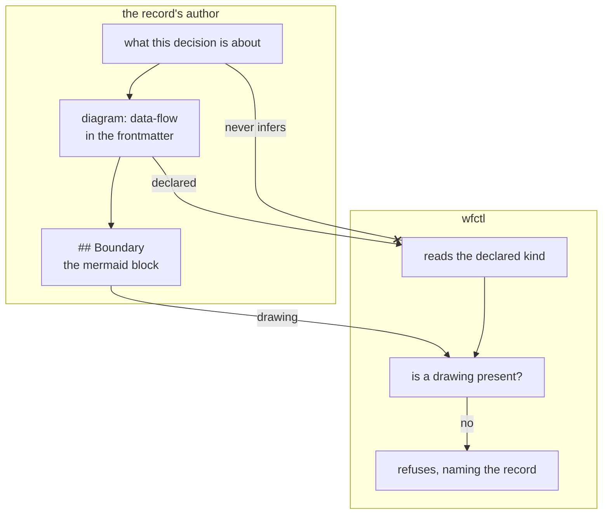

# The author declares the diagram kind, and wfctl checks it

## Decision

The record's author declares which kind of diagram the decision needs, and
wfctl checks only that the record has the drawing. wfctl never decides the kind
itself.

The author writes the kind as a `diagram` key in the frontmatter, naming one of
`data-flow`, `component`, `state`, or `sequence`. The key goes beside `status`
and `supersedes`, not in the body, since a parser reads it, not a person. The
`_frontmatter` function already returns it, and `parse_record` adds it to
`Record` the same way it adds the other two keys.

A record can declare more than one kind as a list, such as `diagram:
[data-flow, sequence]`. Each kind then gets its own `### <kind>` heading under
`## Boundary`, with its drawing below it. If a record declares only one kind,
its drawing goes directly under `## Boundary`, as before. wfctl checks that
every declared kind has a drawing under its heading. It also refuses a list
that names the same kind twice, or a heading for a kind the list doesn't
declare.

## Boundary



The crossed edge is the decision. The other edges show what each side writes
or reads.

## Context

Each record should open with a drawing whose kind fits what the decision is
about, as #109 asks. An ownership decision gets a data-flow diagram, a boundary
gets a component sketch, and a lifecycle gets a state diagram. The open
question is who decides which kind a record needs.

Currently, nothing in a record states its kind. `record-template.md` has one
optional `Boundary` section and no list of what goes in it, so each of the 22
records that already have a drawing picked its shape by feel. Read together,
they're consistent, though no rule made them so. The ownership decisions
created data flows, and the decisions about a thing moving between states
created state diagrams.

The kind is a property of the decision, not of the file.
`wfctl-runs-the-verification.md` is about who may assert a verdict, and
`stop-kind-is-a-field-not-an-event.md` is about what a payload carries. Both
are three paragraphs of English, and neither names its subject as a noun a
parser could find.

## Direct baseline

Name the four kinds in `architecture-decisions/SKILL.md`, add a sentence to
`record-template.md` telling the author to pick the one that fits, and check
nothing. The mapping ships as guidance, and the author follows it or doesn't.

This is how the skill handles `Owns truth` today, and the skill says `Owns
truth` is the section authors drop most often. Its verification list has a line
for the half that goes missing.

We accepted `a-rule-is-expressed-as-a-check.md` to end guidance that has no
check, and its test applies here. A missing drawing is
visible in the record, and the record is a file the work already produces.

## Owns truth

The author decides which kind of diagram the decision needs. The kind follows
from the decision's subject, which is one of four things:

1. A value moving between components.
2. A line between components.
3. The states one thing passes through.
4. A request crossing several actors past a wait.

The record states that subject in prose written for a person.

wfctl can't figure out the kind, because it would have to classify English. It
would have to decide that "who may assert a verdict" is about ownership and
"what a payload carries" is not, across 38 records that share a vocabulary and
differ only in what they're about. Every available mechanism is a keyword
heuristic.

A heuristic that's wrong on one record in ten produces a refusal the author
can't argue with. The only fix is to rewrite the prose until it scores better.
That's worse than no check, because it moves authority over the record's
subject from the person who made the decision to a string match.

wfctl checks whether the record has the drawing it declares. It can check this
from the file alone, and the declaration is what makes it checkable. When a
record declares several kinds, wfctl checks each one and uses the headings to
match each drawing to its kind.

## Considered

- **wfctl infers the kind from the record's prose.** The author writes no key
  and has nothing to get wrong, and the mapping ships as one rule instead of
  two halves. We didn't choose it because the inference would be a keyword
  match over English written for a person. A rule that's occasionally wrong is
  worse here than no rule, because the author can't argue with its refusal.
- **The kind is a heading rather than a key.** The record uses `## Data flow`
  instead of `## Boundary` plus `diagram: data-flow`. This is equally sound,
  but it loses on one point. `_arch` already parses frontmatter into a
  dict and already reads two keys from it, so a third costs one line. A heading
  that varies by kind means the section scanner has to learn four names, and
  `arch context`'s projection has to agree about all of them.
- **No kinds at all.** wfctl requires a drawing and lets the author draw what
  fits. The 22 existing records already do this, and their shapes agree. We
  didn't choose it because of #109's third scope item. Without a declared
  kind, nothing names what a drawing is *of*, so traceability has nothing to
  attach to.
- **Several drawings matched to the declared kinds by order.** The first fenced
  block belongs to the first kind, the second to the second, with no headings.
  We didn't choose it because neither a reader nor wfctl can tell which drawing
  is which. A data-flow and a component sketch are both mermaid flowcharts, so
  swapping two drawings would pass the check.

## Consequences

`Record` has a new `diagram` field, and it's `""` for every record on disk
today. As a result, a missing key has to mean "not declared", never a default
kind. `status` follows the same rule for the same reason.

Because a record can declare several kinds, `Record` also has a `kinds`
property, which reads the declared kinds from `diagram` as a list, with one
entry for a record that declares a single kind. `Record.diagram` keeps the
value as written, so every message that quotes it reads the same as before.
Each refusal names the record, the kind whose drawing is missing, and the fix,
so the agent can act on it without reading this record:

```
✗ review-record-in-git-notes declares a sequence diagram but doesn't draw one.
  Fix: under '## Boundary', add a '### sequence' heading with a mermaid
  sequenceDiagram, including the step that fails (an alt block or a -x message).
```

The four kind names are wfctl's. A test checks them against the template, the
same way a test checks the spec and plan section lists
(`required-sections-are-wfctls.md`). Adding a fifth kind means changing both.

`sequence` is the fourth kind, and `state` doesn't cover it. A `state` drawing
follows one thing through its states. A `sequence` drawing follows a request
across several actors, and its purpose is to show what each actor holds when a
step fails partway. Percival and Gregory draw every flow that crosses a wait
this way (*Architecture Patterns with Python*, Figures 9-4, 11-6, and 12-2),
and each time, the reason they give is a step that can fail on its own.

That's why `wfctl arch accept` refuses a `sequence` record whose drawing has no
failure block and no lost message, and `wfctl doctor` warns about one while
it's proposed. The check reads the declared kind and the drawing's syntax,
never the English. The author still judges which step counts as the failing
one, and the refusal asks only that one is drawn, which is visible in the file.

## Log

- 2026-09-16  proposed    — the level-2 gate for #109, first of two
- 2026-09-25  amended     — #495 adds `sequence` as a fourth kind; still proposed
- 2026-11-09  amended     — #738 lets a record declare more than one kind, each
  under its own heading; still proposed
- 2026-11-09  reordered   — the decision and its drawing come first, per the
  record template's new order (#739); still proposed
- 2026-11-10  accepted    — #738 approved 11/10/26
