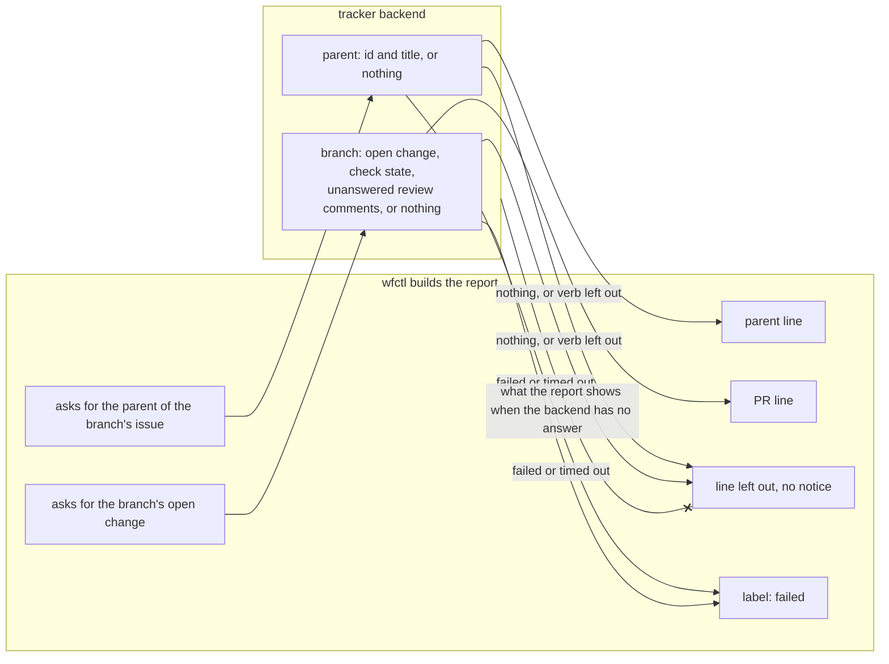

# The session report shows when a tracker lookup fails

## Context

In a worktree, the session-start report shows three things
(`session-report-built-in-code.md`):

1. The branch's issue.
2. The issue's parent epic.
3. The branch's open PR, with whether its checks pass and how many review
   comments are unanswered.

wfctl reads the issue today with `view`, but not the other two.

wfctl calls a PR, a merge request, or a patchset a change, since the tracker
config's `changes` section covers all three. No existing verb reads either
one:

- The issue verbs are `list`, `view`, `close`, `comment`, `create`, `label`,
  `labels`, `fields`, `state`, `start`, and `stop`. None of them returns a
  parent.
- The change verbs are `list`, `view`, and `fields`. Each one takes a change
  id, which a session on a branch with no recorded PR doesn't have.

Each tracker finds a parent and a PR its own way:

- GitHub: a sub-issues API returns an issue's parent, and a PR is found by
  its branch name.
- Jira: a story links to an epic through a field whose name differs between
  projects.
- Gerrit: a patchset belongs to a change, not to a branch.

Some trackers have no parent.

Previously, the report left a line out whenever its lookup gave no answer,
whether the tracker had nothing to report or the lookup failed
(`backend-tracker-reads-parent-and-change.md`). Currently, an agent that sees
no PR line can't tell whether the branch has no PR or the lookup failed or
timed out. If the branch has a PR with failing
checks or unanswered review comments, the agent starts work without knowing
about them. This gap was found in the #432 plan walkthrough.

## Direct baseline

Keep the earlier record's rule: a lookup that fails or times out leaves its
line out, with no notice. This requires no code changes, and the report stays
as short as possible. However, the agent can't tell a failed lookup from
a branch with no PR. That's why the decision below prints failed lookups.

## Decision

The tracker backend has two new read verbs, and a backend can leave out either
one:

1. `parent` takes an issue id. It prints the parent's id and title, or nothing
   when the issue has no parent.
2. `branch`, in the `changes` section, takes a branch name. It prints the
   branch's open change with its check state and its count of unanswered
   review comments, or nothing when the branch has no open change.

When a lookup fails or times out, the report prints its label followed by
`failed`, such as `PR: failed`. When the backend answers with nothing, or
leaves the verb out, the report leaves the line out with no notice. This
applies to all three tracker lines: the issue, the parent, and the PR.

## Owns truth

The backend finds an issue's parent and a branch's open change, in its
tracker's own terms.

wfctl can't compute either one. A parent is a sub-issue link on GitHub and a
project-specific field on Jira. A change is found by branch on GitHub and
by change id on Gerrit, so a Gerrit backend would most likely leave `branch`
out.

wfctl doesn't read any tracker's vocabulary. The `fields` verb returns
attributes under the backend's own key names, and wfctl never reads those
names, on purpose. wfctl draws the same line for whether an issue is open
(`backend-tracker-maps-issue-state.md`).

wfctl decides what the report shows when the backend has no answer, and
whether the lookup failed. The backend can't decide either one. It doesn't
know whether the session-start report called it, and a backend that timed out
or crashed can't report its own failure. wfctl sees the exit code and the
timeout. That's why wfctl decides whether to leave the line out or print
`failed`.

## Boundary

The `--x` edge is the decision. The backend reports what its tracker holds, and
wfctl decides how the report reads, including when the lookup failed.

## Considered

- **Leave a failed lookup out (the direct baseline).** We didn't choose this
  because the agent can't tell a failed lookup from a branch with no PR, and
  misses failing checks and unanswered review comments.
- **Print `not checked` when a backend leaves a verb out.** We didn't choose
  this because it would print the same line in every session in that
  repository, which #434 asks the report to stop doing. `wfctl tracker-check`
  already lists which verbs a backend supports. A `failed` line appears only
  when a lookup fails.
- **Print the error text with the failure.** We didn't choose this because the
  error from `gh` or a script can be long or include the full command line, and
  the agent only needs to know the lookup failed. Rerunning
  `wfctl status --session` shows whether the failure persists.
- **Add no verb.** We didn't choose this because a session picking up a
  reviewed branch needs the PR line first.
- **Read the parent and the PR from `fields`.** We didn't choose this because
  `fields` returns the backend's own key names, and wfctl never reads those by
  name. If wfctl guessed at a key, it would treat every backend that names it
  differently as having no parent.
- **Have the skill run `gh` for these two reads.** We didn't choose this
  because it ties a skill every repository installs to one tracker. It also
  moves the rule about what to load back into the skill's instructions, which
  `session-report-built-in-code.md` moves into wfctl.

## Log

- 2026-11-02  proposed    — the #432 plan walkthrough found that a failed lookup reads as "no PR"
