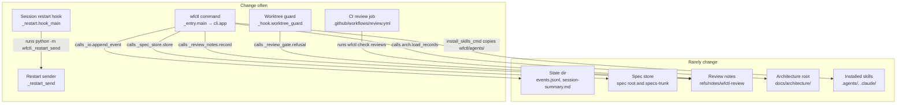

# wfctl container view

wfctl runs as four separate processes and keeps its data in five stores. The
`wfctl` command does most of the work. The worktree guard and the session
restart hook are the same executable started by the agent host on a hook, and
the restart hook sends its keystrokes from a detached process of its own. CI
runs `wfctl` again on GitHub to check a PR's reviews.

Question: which parts of wfctl run or store data separately, and which way do
their dependencies point?

## Drawing

The stores rarely change shape, so they sit above the line, and every arrow
points up into them. No arrow points from a store down to a process, so the
drawing has no red arrow.

## Notes

The installed skills are drawn as a store because `install-skills` writes them
and the agent reads them, and their shape changes only when wfctl ships a new
version. The skills tell the agent which `wfctl` commands to run, but that is an
instruction the agent follows, not an import, so it has no arrow.

The guard reaches the review notes through `_review_gate`, which reads them with
`_review`. It's drawn as one arrow because both modules run inside the guard's
process.
