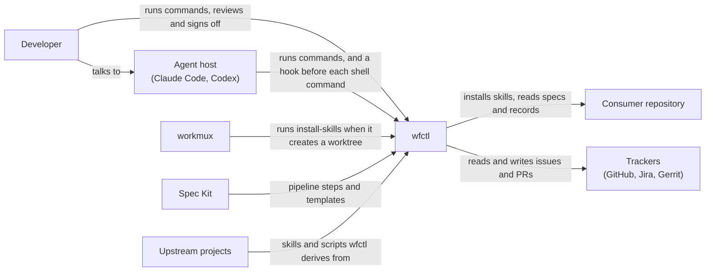

# wfctl system context view

wfctl is a command-line tool that tracks where a feature sits in a spec-driven
pipeline and tells the agent working on it what to run next. A developer works
with an agent inside an agent host such as Claude Code, and both run `wfctl`
commands. wfctl installs its skills into the repository it works on, reads issue
and PR state from a tracker, and relies on workmux to create and remove
worktrees.

Question: who and what does wfctl interact with?

## Drawing

The outside systems are the six parties on the domain page's `Outside parties`
line.

## Notes

Spec Kit and the upstream projects reach wfctl only when someone pulls a new
version of their skills into `wfctl/agents/`. Nothing calls them at runtime.
