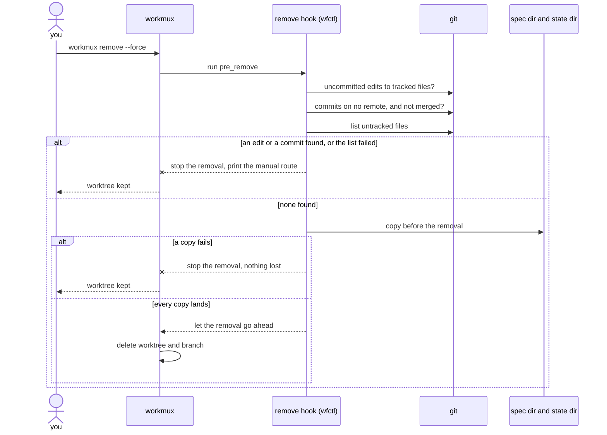

# The remove hook stops a worktree removal that would delete work saved nowhere else

## Context

When you remove a worktree, everything in it that was never committed is
deleted. workmux also deletes the branch by default, so any commits on it that
were never pushed or merged are deleted too.

workmux has its own check, which stops a removal when the worktree has
uncommitted edits or untracked files. Passing `--force` turns that check off,
and `--force` is how most removals are run. As a result, the only thing
protecting a forgotten file during a forced removal is you remembering it.

workmux still runs its hooks when you pass `--force`. Before every removal, the
`pre_remove` hook runs `wfctl archive-specs`, and a failing `pre_remove` stops
the removal. That means wfctl already runs at the last moment this work can be
saved, and it already has a way to stop the removal. Currently, it stops a
removal only when it fails to copy spec files out of the worktree.

The work at risk comes in two kinds, and each needs different handling:

1. An untracked file exists only in the worktree. wfctl can copy it somewhere
   safe, and the removal can then go ahead.
2. An edit to a tracked file, or a commit that never left your machine, is
   usually work you forgot to commit, push, or merge. If wfctl copied it into a
   folder you never open, you wouldn't find out until you went looking for it.

## Direct baseline

The smallest change keeps today's behavior. The hook copies spec files that sit
inside the worktree, and it stops the removal only when that copy fails.
workmux's check is the only protection for tracked edits and untracked files,
and `--force` turns it off. Nothing checks whether the branch's commits exist
anywhere else.

With this baseline, a forced removal deletes an untracked module, an
uncommitted edit, or a branch of commits that only exist locally, and nothing
is printed.

## Decision

The remove hook stops a removal that would delete work saved nowhere else, even
when you pass `--force`. It stops the removal in four cases:

1. A tracked file has uncommitted edits, whether they are staged or not.
2. The branch has commits that are not on any remote branch, and merging the
   branch into the default branch would change the default branch.
3. A copy that the hook makes before the removal fails. The
   `removal-copy-destinations` record describes what the hook copies and where
   each kind of file goes.
4. git can't list the worktree's untracked files.

In every other case, the hook makes its copies and lets the removal go ahead.
The hook stops a removal only when it finds work that would be lost, or when it
can't tell whether the untracked files are saved. If git
can't answer the edit check or the commit check, the hook prints a warning and
lets the removal go ahead. This keeps the existing rule that an unrelated error
never leaves a worktree stuck.

A failed listing of untracked files is the one exception. The hook saves
untracked files rather than stopping for them, so it needs the list to copy
them. Without the list, it has no way to know whether they are saved, and going
ahead would delete every one of them. Stopping costs you one manual step, which
is the route the hook prints.

## Owns truth

wfctl's remove hook decides whether deleting the worktree would destroy work
that exists nowhere else.

workmux shouldn't make that decision, for three reasons.

Because `--force` turns off workmux's check, and most removals use `--force`,
the check only protects the removals that need it least.

Because workmux doesn't look at commits, it can't tell when a removal deletes a
branch of commits that only exist locally.

Because workmux doesn't know about the spec dir or the state dir, it can't tell
whether wfctl's copies succeeded. Only the process that made a copy knows
whether it landed.

git answers the commit check locally. Checking only whether the commits were
pushed gives the wrong answer in one common case. When a pull request is
squash-merged in a repository that deletes the branch on merge, the branch's
own commits end up on no remote, even though the work is in the default
branch. That's why the hook checks whether merging the branch would change the
default branch. If it wouldn't, the work is already there, however it was
merged.

## Boundary

A crossed arrow means the hook stopped the removal.

## Considered

- **Save tracked edits as a patch and let the removal go ahead.** This was the
  issue's first design, and it loses nothing. We didn't choose this because an
  uncommitted edit is usually work you forgot to commit, push, or merge. A patch
  in the state dir hides that from you, while stopping the removal shows it to
  you while the work is still in place.
- **Print a warning when a copy fails and let the removal go ahead.** This never
  leaves a worktree stuck. We didn't choose this because once the worktree is
  deleted, the copy that failed was the only copy.
- **Add an environment variable that lets one removal skip the check.** This
  would turn a deliberate removal into one command instead of two. We didn't
  choose this because the hook already prints the manual route when it stops a
  removal, and that is enough for a case that should be rare.
- **Ask the tracker whether the branch's pull request was merged.** This handles
  the squash-merge case directly. We didn't choose this because it needs the
  network during the removal, and it can't answer for a branch that never had a
  pull request. git answers both cases locally.

## Consequences

`workmux remove --force` no longer removes a worktree with uncommitted edits or
unmerged local commits. If you want to remove it anyway, run the manual route
the hook prints, which is `git worktree remove` followed by `git branch -D`.
Neither command runs the hooks.

The hook can't see `--keep-branch`. If you remove a worktree but keep its
branch, the hook still stops the removal over unmerged commits, even though the
commits would survive. The manual route works for this case too.

The default branch is the same trunk branch that `wfctl start` already
resolves. If merging the branch would cause a conflict, the hook treats that as
changing the default branch and stops the removal.

## Log

- 2026-10-13  proposed    — #40 extends the remove hook from spec files to all
  work a removal would delete, and stops the removal for tracked edits instead
  of saving them
- 2026-10-19  amended     — #613 stops the removal when git can't list the
  untracked files, rather than warning and going ahead. This overrides FR-013
  in the #40 spec for that one check
