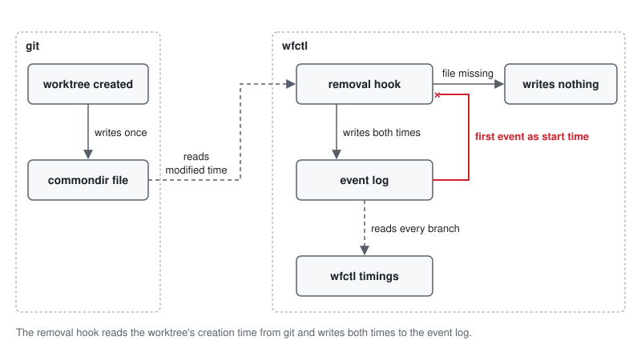

# The removal hook reads worktree creation time from git

## Decision

wfctl measures how long a feature took as the time from worktree creation to worktree removal. When a worktree is removed, the removal hook reads the creation time from git and writes both times to the branch's event log. If git's `commondir` file is missing, or the hook refuses the removal, it writes nothing.

## Boundary

The dotted arrows are values read later from a file. The red edge is the claim the removal hook refuses: the log's first event used as the start time.

## Context

A project sizing the machine its agents run on needs to know how long a feature keeps a worktree open. pfms is moving its worktrees onto one shared codespace (MarinVentures/pfms#1200), and needs this measurement to run more worktrees at once.

Issue #828 first proposed measuring session length from the `start` and `end` events. Session length doesn't show how long a feature took, because the user runs several sessions per context window. An automatic restart also writes `end` and clears the pane, and the next conversation doesn't always write `start`. On #627, the log shows several `end` events with no `start` between them.

That leaves the worktree's lifetime. However, in a consumer repo no wfctl code runs when a worktree is created. pfms's `post_create` hook runs only `wfctl install-skills`, which writes no event. The removal hook (`wfctl hook worktree-remove`) is the only wfctl code that runs at either end of a worktree's life, and pfms still calls it by its older name, `wfctl archive-specs`.

When git creates a worktree, it writes a small file once at `<git common dir>/worktrees/<name>/commondir` and doesn't rewrite it afterward. So its modified time is the worktree's creation time. On this branch's worktree, git wrote the file at 18:31:46Z, and the hook's `issue start` event followed 4 seconds later. The hook reads the modified time rather than the birth time, since Python can't read a file's birth time on Linux, where the codespace runs.

## Direct baseline

The summary pairs each `start` event with the next `end` event on the same branch and reports the time between them. It adds no new event and doesn't read git. However, it fails on the logs wfctl already writes. An automatic restart leaves an `end` with no `start` before it, and a session that runs `/start-session` twice leaves two `start` events. As a result, pairing undercounts sessions and reports lengths that match no real period of work.

## Owns truth

Git owns "when was this worktree created?". wfctl can't record it, because in a consumer repo no wfctl command that writes an event runs at creation. Asking every repo to add one is a configuration change this decision avoids.

The removal hook owns "when was this worktree removed, and did the removal go ahead?". No other wfctl code runs at removal, and only the hook can tell whether it refused. A span written by anything else could record a removal the hook stopped.

The `wfctl timings` command owns no stored value. Each time it runs, it reads every branch's event log and recomputes every median and maximum (`session-state-is-re-derived`). That's why it can't report a stale number.

## Considered

- A new `wfctl hook worktree-create` step in the seeded `.workmux.yaml`, with `wfctl doctor` reporting repos that lack it. We didn't choose this because every consumer repo would have to edit its configuration before measuring anything, and worktrees open today would have no start time.
- `wfctl install-skills` writes a creation event the first time it runs in a worktree. It already runs in both repos' `post_create`. We didn't choose this because it also runs at every session start, so it would need to tell a first run from a later one. And a worktree created without it would have no start time.
- The first event in the branch's event log serves as the start time. We didn't choose this because the first event is whatever wfctl command ran first. In pfms it's a `mode` or `review-sign-off` event, which can come hours after creation, so the span would be wrong by an amount nobody can see.
- Time spent in each column of the GitHub Projects board, read from GitHub's history of column moves. GitHub records every move, automation included. We didn't choose this for #828 because the board's columns are moved partly by hand and partly by automation, and steps get skipped, such as a PR opened for review that never passed through In Progress. Board time shows how an issue moved through the board, not how long a machine was busy, so it gets its own issue.

## Consequences

wfctl now depends on the layout of git's worktree folder, which git doesn't document as a public interface. The layout has been stable across git releases. If the file is missing, the summary counts that branch under "no span" rather than reporting a wrong time. The plan checks which git commands rewrite the `commondir` file, since a rewrite would move the start time forward.

Worktrees removed before this ships, and worktrees removed by hand with `git worktree remove` or `rm -rf`, have no span. The summary reports them as a count, without guessing which of the two causes applies.

A branch can get a worktree more than once. Each worktree counts as its own span, and the summary reports no total for each branch, since sizing a machine needs the spread across worktrees rather than any one branch.

## Log

- 2026-11-19  proposed    — #828 measures feature time from worktree creation to removal instead of session length.
- 2026-11-20  accepted    — Andre accepted in the #828 session after the walkthrough, 2026-11-20 · drawing drawings/worktree-span-read-from-git-data-flow.svg sha256:bb52bb3c4af2
