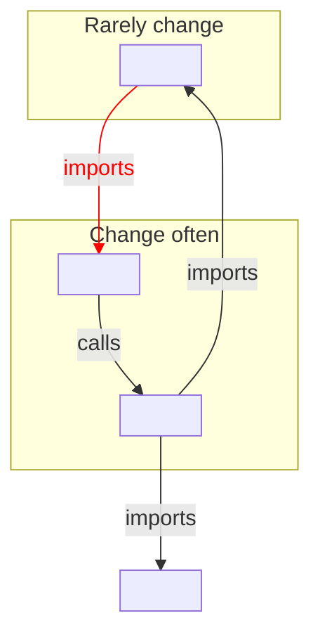

# <Context> component view

<!-- Lands at <arch-root>/views/components/<context>.md — ask `wfctl arch-root`.
     Name the file exactly as the context is spelled on the domain page's
     `Contexts` line. A view describes the context as it is and decides
     nothing; the records under the arch root decide. The agent draws it from
     the code, and the user reviews it.

     `covers` lists the code this drawing comes from, usually the context's own
     package. When a covered path gets a commit newer than this file,
     `wfctl arch context` marks the view stale. Without a `covers` line, the
     view prints as unchecked. -->

<Two or three plain sentences: what this context does, taken from its row in the
domain page's Bounded Contexts table, and the modules it's made of.>

Question: which modules make up <context>, and which way do their dependencies
point?

## Layout

Lay the drawing out by how often each module changes, so a dependency pointing
the wrong way stands out:

1. Modules that rarely change go in an upper subgraph, above a labeled line.
   These are the modules many others depend on, such as the context's data
   types and the functions other contexts import.
2. Modules that change often go in a lower subgraph, below the line. These are
   the modules closest to the user, such as a command's output.
3. Arrows point toward the stable side, so most arrows point up. A volatile
   module that depends on a stable one is sound.
4. An arrow from a stable module to a volatile one is drawn in red with
   `linkStyle`. A change to the volatile module can then break the stable one,
   and every module that depends on it.

Draw the dependencies the code has, not the ones the design intends. A red arrow
is a finding to show the user, not a mistake to leave out of the drawing.

Draw another context only where one of this context's modules imports it, as a
single box outside both subgraphs.

Give every arrow a label naming the import or call in the code that creates it,
such as `-->|"imports _records"|`. The label is what lets the user check any
arrow against the code without trusting the drawing.

## Drawing

<One mermaid flowchart, laid out as above.>

## Notes

<Anything the drawing can't show, such as a red arrow that is already tracked
in an issue. Write `none` rather than deleting the section.>
