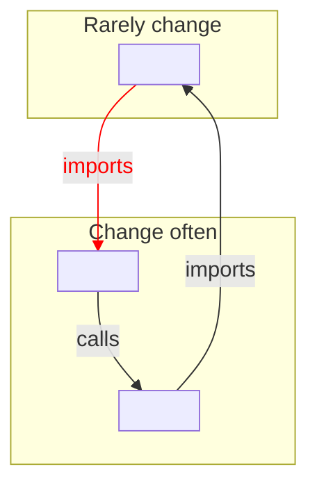

# <System> container view

<!-- Lands at <arch-root>/views/container.md — ask `wfctl arch-root`.
     A view describes the system as it is and decides nothing; the records under
     the arch root decide. The agent draws it from the code, and the user
     reviews it.

     `covers` lists the code this drawing comes from. When a covered path gets a
     commit newer than this file, `wfctl arch context` marks the view stale.
     List only the files whose change would move a box or an arrow, such as the
     one that starts each process. If you list a file most changes touch, such
     as the command parser, the view reads stale on nearly every PR, and readers
     learn to ignore the mark. Without a `covers` line, the view prints as
     unchecked. -->

<Two or three plain sentences: the parts the system is made of and how they
depend on each other. A part here is anything that runs or stores data on its
own, such as a CLI, a hook, a background process, or a file store.>

Question: which parts of <system> run or store data separately, and which way do
their dependencies point?

## Layout

Lay the drawing out by how often each part changes, so a dependency pointing the
wrong way stands out:

1. Parts that rarely change go in an upper subgraph, above a labeled line. These
   are the parts many others depend on, such as shared types and stored formats.
2. Parts that change often go in a lower subgraph, below the line. These are the
   parts closest to the user, such as commands and their output.
3. Arrows point toward the stable side, so most arrows point up. A volatile part
   that depends on a stable one is sound.
4. An arrow from a stable part to a volatile one is drawn in red with
   `linkStyle`. A change to the volatile part can then break the stable one,
   and every part that depends on it.

Draw the dependencies the code has, not the ones the design intends. A red arrow
is a finding to show the user, not a mistake to leave out of the drawing.

Give every arrow a label naming the import or call in the code that creates it,
such as `-->|"imports _records"|`. The label is what lets the user check any
arrow against the code without trusting the drawing.

## Drawing

<One mermaid flowchart, laid out as above.>

## Notes

<Anything the drawing can't show, such as a red arrow that is already tracked
in an issue. Write `none` rather than deleting the section.>
