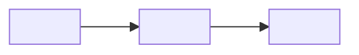

# <System> system context view

<!-- Lands at <arch-root>/views/system-context.md — ask `wfctl arch-root`.
     A view describes the system as it is and decides nothing; the records under
     the arch root decide. The agent draws it from the code, and the user
     reviews it.

     `covers` lists the code this drawing comes from, such as the package and
     the configuration that names each outside system. When a covered path gets
     a commit newer than this file, `wfctl arch context` marks the view stale.
     List only the files whose change would add or remove an outside system. If
     you list a file most changes touch, the view reads stale on nearly every
     PR, and readers learn to ignore the mark. Without a `covers` line, the view
     prints as unchecked. -->

<Two or three plain sentences: what the system does, who uses it, and which
outside systems it depends on. Someone who has never seen the code should be
able to read this paragraph and know what the drawing is about.>

Question: who and what does <system> interact with?

## Drawing

<One mermaid flowchart. Put the system in the middle as one box, with nothing
inside it. Around it, draw each person who uses it and each outside system it
calls or is called by, taking the outside systems from the domain page's
`Outside parties` line. Label each arrow with what crosses it, such as "runs
commands" or "reads issues".>

## Notes

<Anything the drawing can't show, such as a system that's only reached in some
setups. Write `none` rather than deleting the section.>
