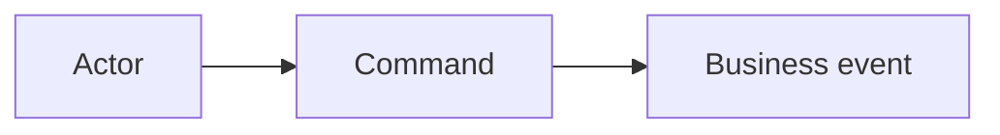
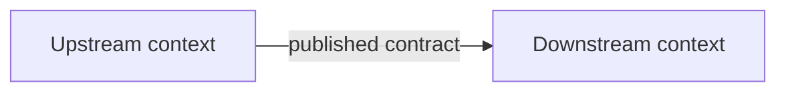
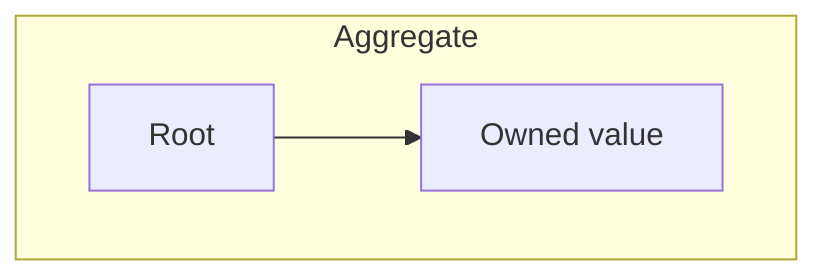

# <Capability> domain model

<!-- Lands at <arch-root>/domain/<capability>.md — ask `wfctl arch-root`.
     This document describes; the records under the arch root decide. Link to
     a record rather than restating it. Keep a `none — <reason>` entry rather
     than deleting a section that does not apply. -->

State: exploratory | proposed | accepted | reflects accepted records
Contexts: <short kebab-case name for each Bounded Context in the table below, comma-separated>
Outside parties: <short kebab-case name for each party outside the capability, comma-separated>
Person who knows the domain: <name or role>
Last checked against the code: <date and commit>
Records this model draws on: <slugs, or none>

## Domain vision statement

<About a page: what this capability does that a customer could not get
elsewhere, and the value it brings. Leave out what does not distinguish it —
qualities such as speed or availability belong in architecture records, not
here. Classify the capability as core, supporting or generic, and say which
answer put it there. Link the product's statement instead when one already
exists. Revise it as the model deepens.>

## Decision frame

Business outcome:
Decision this round supports:
In scope:
Out of scope:
Constraints:

## Evidence

One numbered entry per claim, so later sections can point back to it as E1, E2.

1. <claim> — `<label>`, from <source>. Contradicts: <entry, or none>.

Labels: `observed`, `stated`, `inferred`, `open`. A decided claim links to its
record instead of carrying a label.

## Scenarios

One numbered entry per scenario, so later sections can point back to it as S1, S2.

1. **<actor> wants to <intent>.** They <command>. The rules that apply:
   <rules>. The result is <outcome>, and <events> happen.
   - If <alternative or failure>, then <what happens instead>.
   - Evidence: <E entries>.

### Behavior

Question answered: <question>

What it shows: <the conclusion, or the tension it exposes>

## Ubiquitous Language

One entry per term, alphabetical.

- **<term>** (<context>): <meaning>. For example, <example>. Not to be confused
  with <synonym or forbidden meaning>. Evidence: <E entries>.

## Subdomains

One entry per capability.

- **<capability>** is <core, supporting, or generic>, because <why>. <owner>
  owns it, and <what changes it> changes it.

## Bounded Contexts

| Context | Purpose | Owned language and facts | Includes | Excludes | Owner |
| --- | --- | --- | --- | --- | --- |

### Context Map

Question answered: where do meaning, authority and translation change?

One entry per arrow in the drawing.

- **<upstream> → <downstream>** (<team relationship>): <mechanism>, translated
  by <translation owner>. If it fails or falls behind, <consistency and failure>.

## Invariants and Aggregates

Invariants, numbered so an Aggregate can point back to them as I1, I2. State
each one so it can be false.

1. <invariant>. It's decided when <moment>, needs <information>, and is enforced
   by <enforcer>. If two changes race, <concurrency>, and a violation costs
   <cost>.

Aggregates:

- **<aggregate>**, rooted at <root>, protects <I entries> inside <transaction
  boundary>. It refers to <other Aggregates> by identity only, and emits
  <events>.

### Aggregate

Question answered: what must stay consistent together?

## Implementation feedback

- <S or I entry>: <code, test, or spike> shows <what it means for the model>.
  Status: <status>.

## Decisions

Records only — one line each, linked. The reasoning lives in the record.

- `<slug>` — <one line>

## Open questions

1. <question or conflict>. It matters because <why>. <who> can answer it, and
   <next evidence> would settle it.

## What reopens this model

- <evidence or event that should bring this model back>
